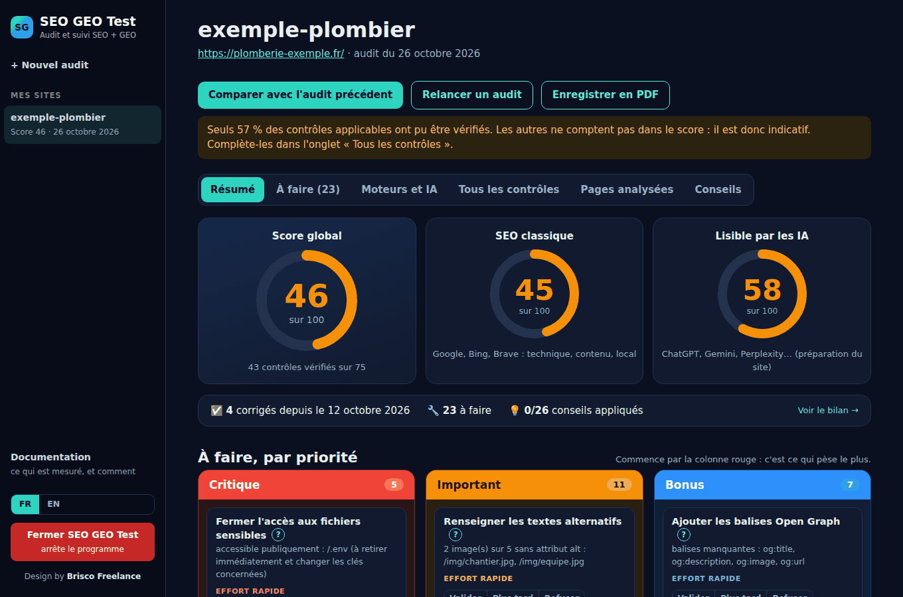
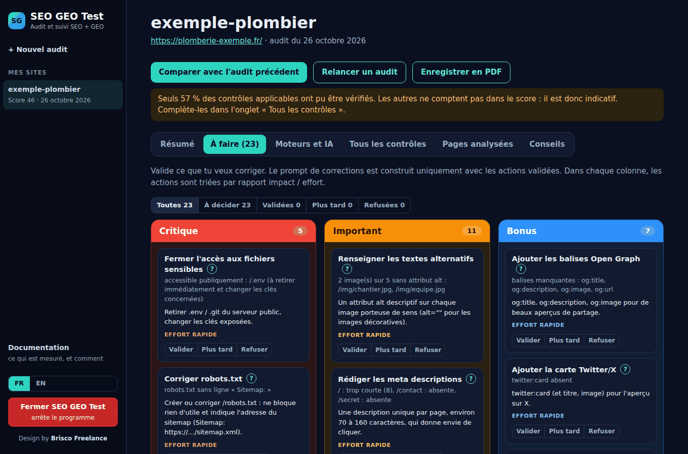
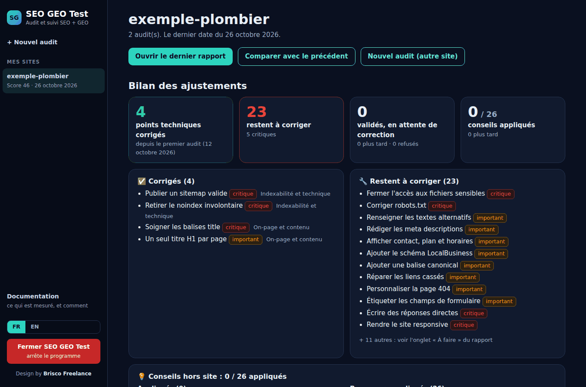
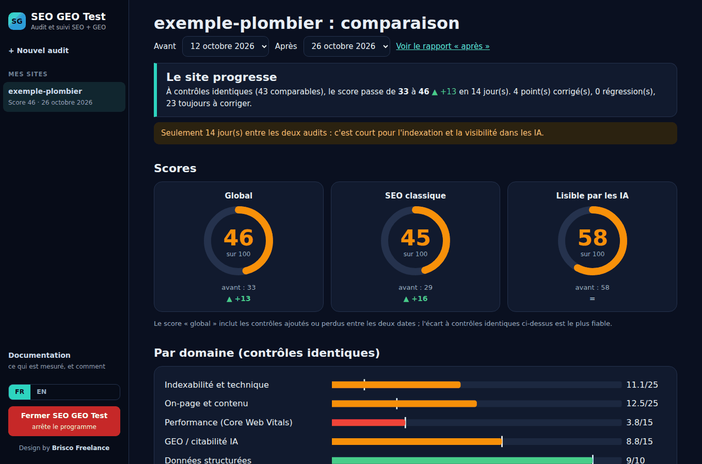

# SEO GEO Test

**Une application gratuite d'audit SEO + GEO qui tourne sur ton propre ordinateur.** Tu colles l'adresse d'un site, tu obtiens un rapport avec des scores, une liste d'actions classées par priorité, et la comparaison avec l'audit précédent. Elle vérifie le SEO classique (Google, Bing, Brave) **et** le GEO : la capacité du site à être compris et cité par ChatGPT, Gemini, Perplexity ou Copilot.

Français · [English](README.md)



> **SEO** = être trouvé et bien classé par les moteurs de recherche. **GEO** (Generative Engine Optimization) = être compris, cité et recommandé par les assistants IA.

## Pourquoi

- **Gratuit, sans compte, sans clé d'API, sans abonnement.**
- **Tout reste sur ton PC.** Pas de cloud, pas de statistiques, rien n'est envoyé à l'auteur. Les rapports sont de simples fichiers JSON dans le dossier `reports`.
- **Des chiffres honnêtes.** Le score ne compte que les contrôles réellement vérifiés. Ce qui n'est pas vérifié est affiché comme tel, jamais deviné. Une IA n'a pas de « rang » : on mesure si elle *mentionne* ou *cite* le site, jamais une position inventée.
- **Fait pour agir.** Chaque contrôle en échec devient une action avec explication (bouton `?`), effort estimé et couleur : rouge = critique, orange = important, bleu = bonus. Les actions validées deviennent un prompt prêt à coller dans ton assistant de code IA.

## Fonctions

- **81 contrôles en 7 domaines** : indexabilité et technique, on-page et contenu, performance (Core Web Vitals via PageSpeed Insights), GEO / citabilité IA, données structurées, local et international, webdesign et mise en ligne.
- **Trois scores** : global, SEO classique, lisible par les IA. La comparaison entre deux audits se fait à contrôles identiques : un score ne peut pas bouger simplement parce qu'on a vérifié plus de choses.
- **Colonnes de priorité** : Critique / Important / Bonus, avec *Valider / Plus tard / Refuser* sur chaque action.
- **Mesure de visibilité** (facultative) : Brave, Bing, Perplexity, ChatGPT, Gemini et Copilot, pilotés dans une fenêtre de navigateur dédiée avec *tes propres* comptes. Arrêt au premier captcha, aucun contournement. Google n'est jamais interrogé automatiquement : importe plutôt l'export CSV de Search Console (un bouton raccourci l'ouvre).
- **Bilan des ajustements** par site : points corrigés depuis le premier audit (constatés par l'audit, pas déclarés), ce qui reste, conseils hors site appliqués.
- **Onglet Conseils** : une checklist à cocher pour ce qui se passe hors du site : fiche Google Business, Apple Plans, Bing Places, annuaires, avis, liens, présence pour les IA. Hors score.
- **Documentation intégrée** : chaque contrôle, ce qu'il signifie et pourquoi il compte.
- **Interface en français et en anglais** (bouton en bas à gauche), export PDF, design « cockpit » sombre.

| À faire, par priorité | Conseils hors site |
|---|---|
|  |  |

| Bilan des ajustements | Comparer deux audits |
|---|---|
|  |  |

## Installation

Il faut **Node.js 18 ou plus** ([nodejs.org](https://nodejs.org), version LTS). Rien d'autre.

**Windows**

1. Télécharge ou clone ce dépôt.
2. Double-clique sur `app\Lancer-SEO-GEO-Test.bat`. Au premier lancement, un petit composant (`playwright-core`) s'installe, puis ton navigateur s'ouvre.
3. Facultatif : clic droit sur le `.bat` > Envoyer vers > Bureau (créer un raccourci).

**macOS / Linux**

```bash
cd app
npm install --omit=dev
SEOLAB_OPEN=1 node server.mjs      # puis ouvre l'adresse affichée dans le terminal
```

Le serveur n'écoute que sur `127.0.0.1` (port 4177, ou le suivant s'il est pris). Le lanceur est écrit pour Windows ; le moteur d'audit et les tests tournent aussi sous Linux. macOS n'est pas testé.

Pour l'arrêter, utilise le bouton rouge **Fermer** de l'application.

## Utilisation

1. Colle l'adresse d'un site et lance l'audit. Coche **Site local** si tes clients viennent d'un lieu précis (cela ajoute les contrôles locaux), et **Plusieurs langues** pour un site multilingue. L'application explique ces deux cases.
2. Lis le **Résumé**, valide ce que tu veux corriger dans **À faire**, copie le prompt généré dans la session qui construit ton site.
3. Relance un audit plus tard et ouvre **Comparer**.
4. Facultatif : coche *Mesurer aussi ma visibilité*. Une seule fois, utilise **Préparer les connexions** sur la page d'accueil, connecte-toi toi-même à ChatGPT, Gemini et Copilot, puis ferme la fenêtre.

## Confidentialité

- Rapports, décisions, requêtes suivies et conseils cochés sont des fichiers dans `reports/`. Supprimer depuis l'application déplace dans `reports/_corbeille` ; rien n'est effacé pour de bon.
- Le serveur n'accepte que les requêtes de ta propre machine ; les requêtes qui modifient quelque chose portent un en-tête dédié et sont contrôlées.
- Le réseau n'est utilisé que quand tu lances une action : lecture du site audité, PageSpeed Insights (si coché), requêtes aux moteurs que tu choisis de mesurer, et, au premier lancement seulement, téléchargement de `playwright-core` depuis npm.
- Les connexions aux IA sont dans le profil du navigateur dédié `app/browser-profile/`. **Ne copie ni ne partage jamais ce dossier.** Il est dans le `.gitignore`.

## Mesure des moteurs et des IA : à lire

Brave, Bing, Perplexity, ChatGPT, Gemini et Copilot interdisent en général les requêtes automatisées dans leurs conditions d'utilisation. Cet outil garde un volume faible, reste volontairement lent, utilise tes propres comptes et s'arrête au premier captcha, mais **tu l'utilises à tes risques**. Si un site change sa page, la mesure échoue avec un message clair au lieu de renvoyer de fausses données. Google n'est jamais automatisé. Les réponses des IA varient beaucoup d'un jour à l'autre : sous 10 réponses par IA, les chiffres sont signalés comme peu fiables.

## Ce qu'elle ne fait pas

- Elle ne modifie jamais ton site : elle lit, puis prépare un prompt.
- Elle ne peut pas tout juger (confort au clavier, vraies photos, état de ton compte Google…). Ces contrôles restent *non vérifiés* tant que tu ne les tranches pas à la main.
- Un bon score veut dire « bien préparé », pas « premier ». Personne ne peut promettre un classement.

## Développement

```bash
cd app
npm install
npm test                      # moteur d'audit + test de bout en bout sur un faux site local
node test/e2e3.mjs            # mesure par navigateur sur de fausses pages de moteurs (Chrome/Chromium requis, variable SEOLAB_CHROME)
```

Aucune dépendance d'exécution sauf `playwright-core` (uniquement pour la mesure par navigateur). Interface en JavaScript pur, sans étape de build. Les contrôles sont dans `app/data/checks.json`, les conseils hors site dans `app/data/tips.json`, les textes anglais dans `app/lib/en*.mjs`.

Les issues et pull requests sont bienvenues, surtout pour de nouveaux contrôles, des traductions et des tests sous macOS.

## Crédits et licence

Licence MIT, voir [LICENSE](LICENSE). Design par [Brisco Freelance](https://briscofreelance.vercel.app/). Sans lien avec Google, Microsoft, OpenAI, Anthropic, Perplexity, Brave ou Apple ; les noms de produits appartiennent à leurs propriétaires.
