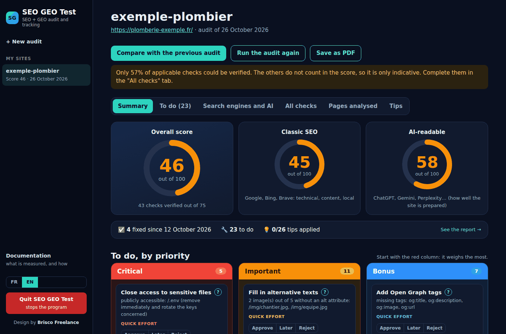
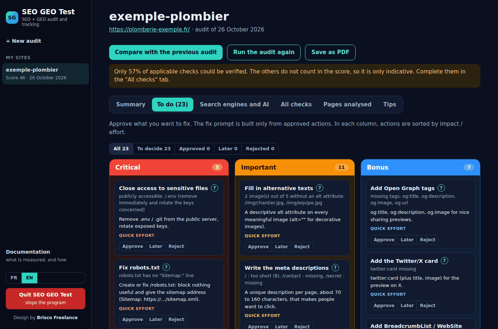
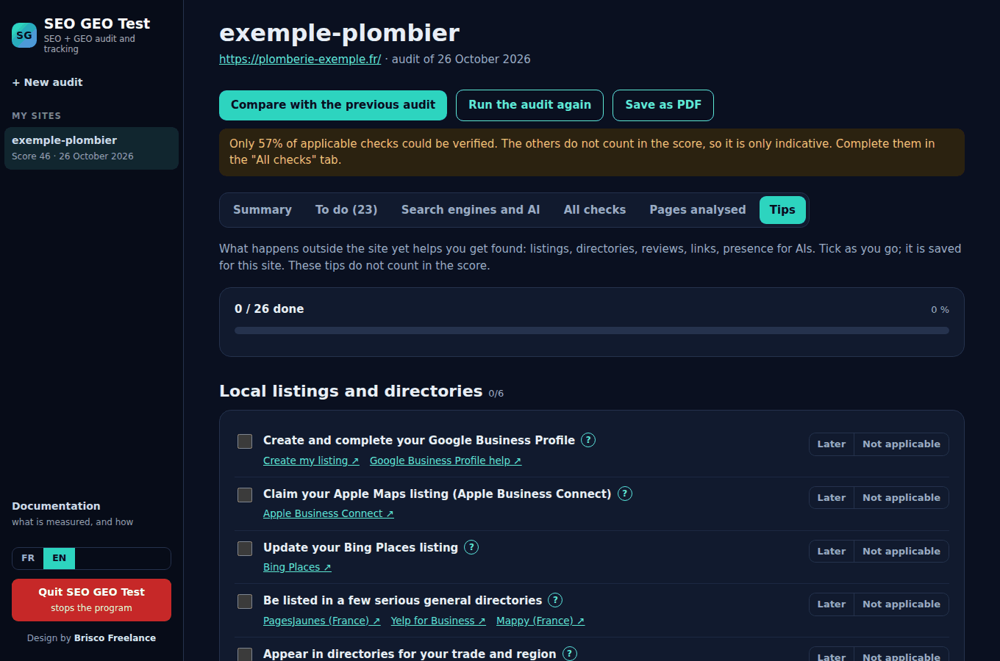
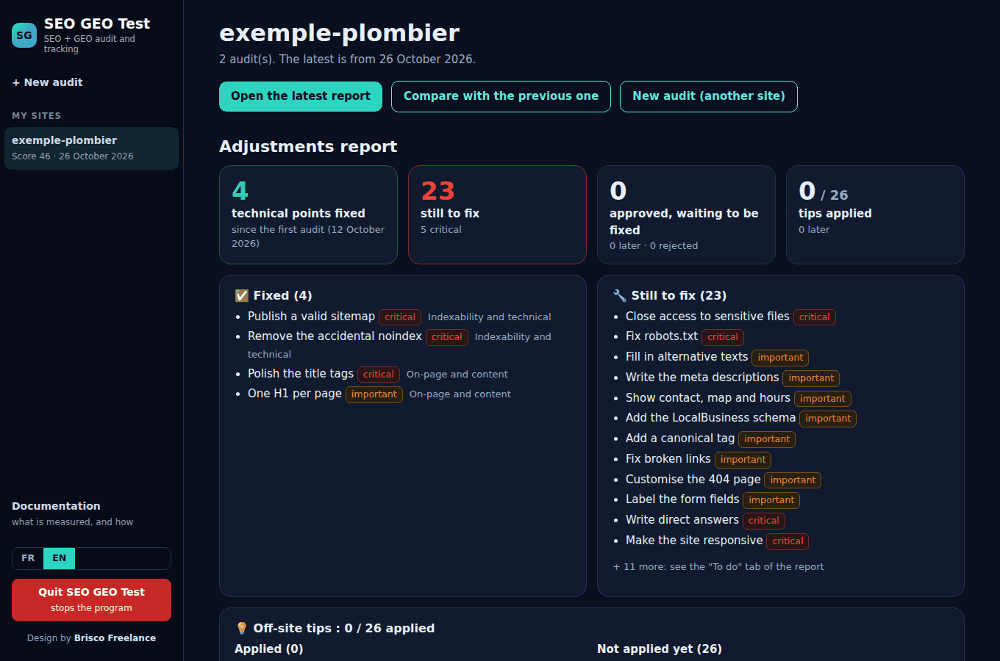
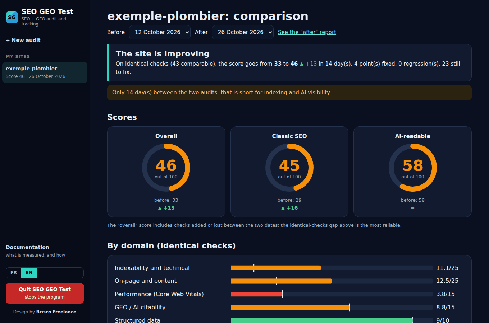

# SEO GEO Test

**A free SEO + GEO audit app that runs on your own computer.** Paste a site address, get a scored report, a prioritised to-do list, and a comparison with your previous audit. It checks classic SEO (Google, Bing, Brave) **and** GEO: how ready your site is to be understood and cited by ChatGPT, Gemini, Perplexity or Copilot.

[Français](README.fr.md) · English



> **SEO** = being found and ranked by search engines. **GEO** (Generative Engine Optimization) = being understood, cited and recommended by AI assistants.

## Why

- **Free, no account, no API key, no subscription.**
- **Everything stays on your PC.** No cloud, no telemetry, nothing sent to the author. Reports are plain JSON files in the `reports` folder.
- **Honest numbers.** The score only counts checks that were really verified. Unverified checks are shown as such, never guessed. AIs have no "rank", so they are measured as *mentioned* / *cited*, never with an invented position.
- **Made to be acted on.** Each failing check becomes an action with an explanation (the `?` button), an effort estimate and a colour: red = critical, orange = important, blue = bonus. Approved actions become a ready-to-paste prompt for your AI coding assistant.

## Features

- **81 checks in 7 domains**: indexability and technical, on-page and content, performance (Core Web Vitals via PageSpeed Insights), GEO / AI citability, structured data, local and international, web design and go-live.
- **Three scores**: overall, classic SEO, AI-readable. Comparison between two audits is done on identical checks, so a score cannot move just because more things were verified.
- **Priority columns**: Critical / Important / Bonus, with *Approve / Later / Reject* on each action.
- **Visibility measurement** (optional): Brave, Bing, Perplexity, ChatGPT, Gemini and Copilot, driven in a dedicated browser window using *your own* accounts. It stops at the first captcha and never bypasses anything. Google is never queried automatically: import the Search Console CSV export instead (a shortcut button opens it).
- **Adjustments report** per site: points fixed since the first audit (observed by the audit, not declared), what remains, and off-site tips applied.
- **Tips tab**: a tickable checklist for what happens outside your site: Google Business Profile, Apple Maps, Bing Places, directories, reviews, links, presence for AIs. Not part of the score.
- **Built-in documentation** listing every check, what it means and why it matters.
- **English and French** interface (switch at the bottom left), PDF export, dark cockpit design.

| To do, by priority | Off-site tips |
|---|---|
|  |  |

| Adjustments report | Compare two audits |
|---|---|
|  |  |

## Install

You need **Node.js 18 or newer** ([nodejs.org](https://nodejs.org), LTS version). Nothing else.

**Windows**

1. Download or clone this repository.
2. Double-click `app\Lancer-SEO-GEO-Test.bat`. The first launch installs one small component (`playwright-core`), then your browser opens.
3. Optional: right-click the `.bat` file > Send to > Desktop (create shortcut).

**macOS / Linux**

```bash
cd app
npm install --omit=dev
SEOLAB_OPEN=1 node server.mjs      # then open the address printed in the terminal
```

The server listens on `127.0.0.1` only (port 4177, or the next free one). The launcher is written for Windows; the audit engine and tests also run on Linux. macOS is untested.

To stop it, use the red **Quit** button in the app.

## Using it

1. Paste the address of a site and run the audit. Tick **Local business** if your customers come from a specific place (it adds the local checks), and **Several languages** for multilingual sites. The app explains both boxes.
2. Read the **Summary**, approve what you want to fix in **To do**, copy the generated prompt into the session that builds your site.
3. Run the audit again later and open **Compare**.
4. Optionally tick *Also measure my visibility*. First time only, use **Prepare sign-ins** on the home page, sign in to ChatGPT, Gemini and Copilot yourself, and close the window.

## Privacy

- Reports, decisions, tracked queries and ticked tips are files in `reports/`. Deleting from the app moves things to `reports/_corbeille`; nothing is erased for good.
- The server only accepts requests from your own machine, and state-changing requests carry a custom header and are origin-checked.
- Network traffic happens only when you launch it: reading the audited site, PageSpeed Insights (if ticked), queries to the engines you choose to measure, and, on first launch only, downloading `playwright-core` from npm.
- AI sign-ins live in the dedicated browser profile `app/browser-profile/`. **Never copy or share that folder.** It is in `.gitignore`.

## Measuring engines and AIs: read this

Brave, Bing, Perplexity, ChatGPT, Gemini and Copilot generally forbid automated queries in their terms of service. This tool keeps the volume low, is deliberately slow, uses your own accounts, and stops at the first captcha, but **you use it at your own risk**. If a site changes its page, the measurement fails with a clear message instead of returning fake data. Google is never automated. Results from AIs vary a lot from one day to the next: below 10 answers per AI the figures are flagged as unreliable.

## What it does not do

- It never modifies your site. It reads, then prepares a prompt.
- It cannot judge everything (keyboard comfort, real photos, your Google account state…). Those checks stay *unverified* until you settle them by hand.
- A good score means "well prepared", not "ranked first". Nobody can promise rankings.

## Development

```bash
cd app
npm install
npm test                      # audit engine + end-to-end on a local fake site
node test/e2e3.mjs            # browser measurement on fake engine pages (needs Chrome/Chromium, set SEOLAB_CHROME)
```

Zero runtime dependencies except `playwright-core` (only for browser measurement). Vanilla JS front end, no build step. Check definitions are in `app/data/checks.json`, off-site tips in `app/data/tips.json`, English texts in `app/lib/en*.mjs`.

Issues and pull requests are welcome, especially new checks, translations and macOS testing.

## Credits and licence

MIT licence, see [LICENSE](LICENSE). Design by [Brisco Freelance](https://briscofreelance.vercel.app/). Not affiliated with Google, Microsoft, OpenAI, Anthropic, Perplexity, Brave or Apple; product names belong to their owners.
